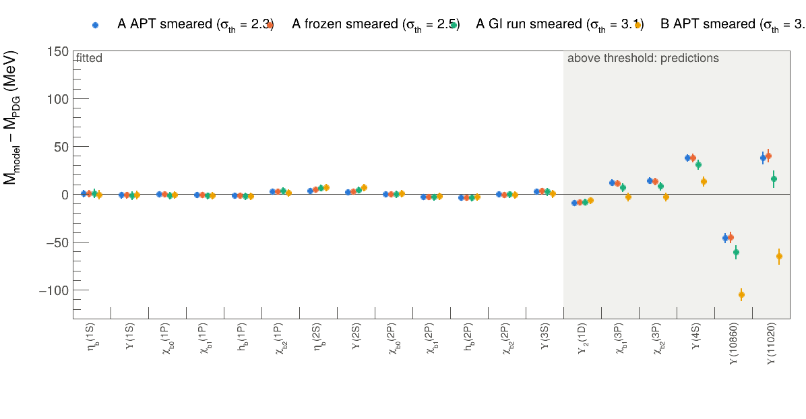
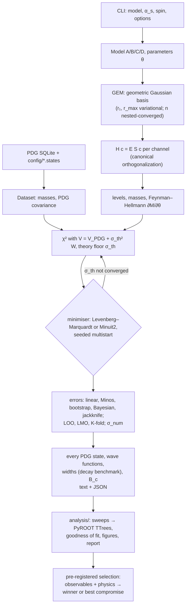

# Quarkonium-System

[](https://github.com/LeventKaanOguz/Quarkonium-System/actions/workflows/build.yml)
[](https://github.com/LeventKaanOguz/Quarkonium-System/actions/workflows/clang-format.yml)
[](LICENSE)

Heavy-quarkonium spectroscopy (c c̄, b b̄, B_c) with the **Gaussian Expansion Method**, in C++23 with Eigen and an
optional **CERN ROOT** layer (Minuit2 minimisation, PyROOT analysis). Four potential models, five forms of the
running coupling, three treatments of the spin terms and their extensions are fitted to every PDG state below the
open-flavour threshold. They predict every other PDG state, the leptonic and two-photon widths, and the B_c, and
are compared by a full statistical analysis.

<p align="center"></p>

**Results** ([report](docs/report/REPORT.md)):

- **No model passes the pre-registered selection** (good masses *and* decays, *and* physically sound). Of 19
  physical models, 7 fail exactly one check, each a different one:
  - the spin terms in the Hamiltonian overpredict Γ_γγ(χ_c0) 5–17×;
  - screened running-coupling models underpredict Γ_ee(Υ(3S)) by a third;
  - constant-coupling models miss the lattice string tension or m_b − m_c.

  Best compromise: the GI-relativized model with constant α_s (C const, s free).
- **Masses at one declared error** (Paule–Mandel, pooled: c c̄ 13.3 MeV, b b̄ 3.9 MeV) pass in 17 of 19 models.
  Without a theory error every model is rejected; the decays and the physics checks decide.
- **The decay test was amended after the results were seen.** The linear test cannot reject an overprediction:
  its pull is bounded below by −1/f. Both the linear and the log form are now required, so the amendment only
  adds rejections. All three verdicts are reported.
- **Lowest theory floor:** A APT smeared, at 7.3 / 2.3 MeV. It has the best LOO predictive density, but
  √b = 0.34–0.37 GeV, against about 0.44 GeV on the lattice.
- **One string tension for c c̄ and b b̄** is accepted in 12 of 19 models. The joint fit brings the median B_c
  miss from 28 to 10 MeV.
- **Above the open-flavour threshold** every model misses by 30–100 MeV, the size of the coupled-channel shifts
  these models omit.

**Documentation:** [analysis report](docs/report/REPORT.md) · [method](docs/EXPLANATION.md) ·
[verification map](docs/VALIDATION.md) · [roadmap](ROADMAP.md) · [lecture notes](docs/notes/quarkonium_gem_notes.pdf)

## Models

| | kinetic energy | potential | α_s (`--running`) |
|---|---|---|---|
| **A** | p²/2m_r, or √(p²+m²) − m (`--kinetic rel`) | Cornell −4α_s/3r + br, Breit–Fermi spin terms | `const` `gi` `frozen` `apt` |
| **B** | as A | A with screened confinement (b/μ_s)(1 − e^{−μ_s r}) | `const` `gi` `frozen` `apt` |
| **C** | √(p²+m²) | Godfrey–Isgur relativized (smeared, momentum-dependent) | `const` `gi` `free` |
| **D** | √(p²+m²) | C with screened confinement | `const` `gi` `free` |

Options: an additive constant c (`--c on`), the spin treatment of A/B (`--spin none|first|smeared`), a fitted
screening mass (`--fit-mu-s`), and for C/D the smearing slope s in place of σ₀ (`--fix sigma0=0.1 --free s`).
That gives 80 configurations, all fitted and compared.

## Build and test

Requirements: CMake ≥ 4.1, a C++23 compiler (GCC 14+), Eigen ≥ 5.0, GoogleTest, SQLite3.
Optional: CERN ROOT ≥ 6.30 (Minuit2; detected automatically, and then the default minimiser), Python 3 with
numpy and scipy (analysis tests).

```bash
cmake --preset release && cmake --build --preset release && ctest --preset release
cmake --preset asan    && cmake --build --preset asan    && ctest --preset asan     # sanitizers
```

The PDG data are the PDG's SQLite file `pdg-2026.0.sqlite` (PDG API page, pdg.lbl.gov), placed in `data/`. It is
not redistributed, so tests that need it are skipped without it; this includes the CI.

## Run

```bash
./build/release/qgem                                   # model A, constant α_s: c c̄ and b b̄ fits, B_c prediction
./build/release/qgem --model A --running apt --spin smeared --loo --lmo
./build/release/qgem --model D --running const --fix sigma0=0.1 --free s
./build/release/qgem --kfold 4 --learning-curve --nested-check 0.1
./build/release/qgem --model A --running apt --spin smeared --shared b      # joint fit: one string tension
./build/release/qgem --model A --running apt --spin smeared --fit-widths    # masses and widths together
./build/release/qgem --bootstrap 400 --mcmc 6000 --threads 8 --out result.json   # Bayesian posterior
./build/release/qgem --help
```

Per system the output gives:

- the fit: its theory floor σ_th with the Q-profile interval, and the χ² with experimental errors alone;
- the parameters with errors and correlations;
- every PDG state with its model value, parametric and numerical errors, pull and leverage;
- size, velocity and the truncation diagnostic of every state;
- every wave function: partial-wave weights, norm, radial nodes, expansion coefficients (`--wavefunctions`);
- the e⁺e⁻ and γγ widths at LO and NLO with parametric and theory errors, and the decay benchmark;
- with `--loo`/`--lmo`, held-out predictions and their calibration; with `--mcmc`, the Bayesian
  posterior and its posterior predictive checks; with `--shared`, the joint fit and the B_c.

`--out` writes the same as JSON.

## Analysis

```bash
python3 analysis/sweep.py all      # every sweep, in dependency order (hours; resumable)
python3 analysis/sweep.py stop     # stop running sweeps and their fits
python3 analysis/analyze.py        # ROOT file, figures, CSV and tables -> docs/report/
```

The analysis uses the system Python that ships PyROOT, plus numpy and scipy. With uv, create the venv with
`--system-site-packages` so that ROOT stays visible.

A model wins only by a pre-registered rule: it must reproduce the observables (Pearson χ² of the masses at
one declared error, and of the measured widths in Γ and in ln Γ as a held-out benchmark, Holm-corrected) and be physically
sound (non-degenerate, converged, correct radial nodes, heavy-quark masses, lattice string tension, P-wave
spin structure, ⟨v²⟩ < 0.5); among those, the lowest AIC. Also reported:

- Bayesian posteriors with the theory floor marginalised, and posterior predictive checks;
- information criteria (AIC, AICc, BIC, Laplace evidence) at the declared error and at 10 MeV;
- likelihood-ratio tests with Holm and Benjamini–Hochberg corrections;
- cross-validation (leave-one-out, leave-multiplet-out, repeated K-fold, learning curves);
- predictions of the states above threshold;
- residual-structure tests;
- model averaging (Akaike, pseudo-BMA, stacking);
- the rank agreement of all these criteria (Kendall τ).

Parameter errors are compared five ways: linear, Minos, bootstrap, MCMC and jackknife.

## Method



Detailed chart: [docs/figures/algorithm.svg](docs/figures/algorithm.svg); walk-through:
[docs/EXPLANATION.md](docs/EXPLANATION.md).

## Layout

| path | contents |
|---|---|
| `src/core`, `src/math`, `src/linalg` | types, special functions, quadrature, generalized eigensolver |
| `src/basis`, `src/me` | Gaussian bases (real and complex-range); closed-form matrix elements |
| `src/spin` | ⟨S₁·S₂⟩, ⟨L·S⟩, ⟨S₁₂⟩, channels |
| `src/models` | parameters, matrix cache, models A/B (`nr_model`), C/D (`gi_model`), running couplings |
| `src/solve`, `src/obs`, `src/hyper` | levels and tracking; observables; basis optimisation and convergence |
| `src/data`, `src/fit`, `src/stats` | PDG reader; χ², minimisers, theory floor, cross-validation; bootstrap, MCMC |
| `src/root` | optional ROOT bridge: Minuit2 Migrad/Hesse/Minos |
| `src/report`, `src/apps` | the end-to-end run and the `qgem` CLI |
| `config/` | which PDG state is which model level |
| `tests/` | GoogleTest (`root/`: ROOT build; `validation/`: slow statistics suite) |
| `analysis/` | sweep driver; statistics (`model_selection.py`), tables, figures, report driver |
| `docs/` | report, method, verification map, algorithm chart, lecture notes |

Units: GeV and GeV⁻¹, ħ = c = 1.

## Citation and license

Altuğ Özpineci and Levent Kaan Oğuz. See [CITATION.cff](CITATION.cff). Released under the [MIT license](LICENSE).
