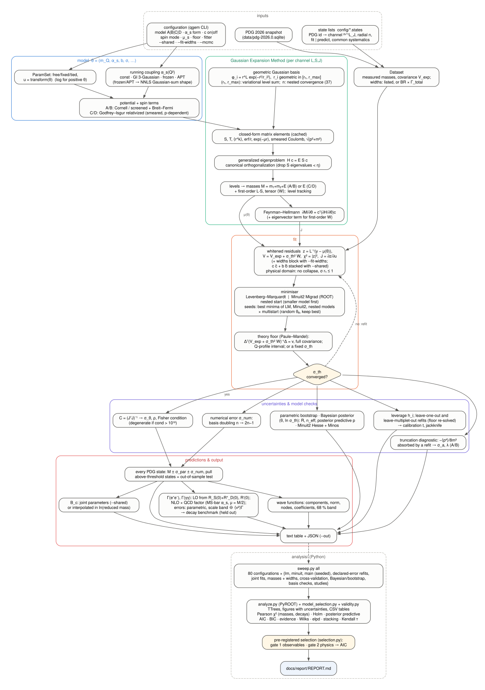

# How qgem works

This is a guided tour of the project: the physics question, the four Hamiltonians, the numerical method,
the fit and its statistics, and where each piece lives in the code. It follows the algorithm chart
below from top to bottom. Results and their interpretation are in [`report/REPORT.md`](report/REPORT.md);
the derivations behind every formula are in the lecture notes [`notes/quarkonium_gem_notes.pdf`](notes/quarkonium_gem_notes.pdf)
(cited as §x.y).



---

## 1. The question

A heavy quark and its antiquark (c c̄, b b̄, or the mixed b c̄) move slowly enough (v² ≈ 0.25 for charm,
0.1 for bottom) that a Schrödinger-type equation with a static potential describes them well. The potential
is not computable from first principles in closed form, so it is *modelled*: a short-distance one-gluon
exchange (Coulomb-like, strength α_s) plus a long-distance confining part (linear, string tension b), plus
spin-dependent corrections. The free parameters are fitted to the measured meson masses, and the fitted
model then **predicts** everything else: the states above the open-flavour threshold, the B_c, the decay
widths. The project asks two questions:

1. *Which model and which form of the running coupling describe the data best*, judged by several
   independent criteria, not one?
2. *How well are the predictions determined*, with the errors from the data, from the numerics and from
   the model separated?

## 2. The four Hamiltonians

| | kinetic energy | potential | spin terms |
|---|---|---|---|
| **A** | p²/2μ, or Σ(√(p²+m_i²) − m_i) with `--kinetic rel` | −4α_s/3r + b r + c | Breit–Fermi: contact (smeared δ), spin–orbit, tensor |
| **B** | same | −4α_s/3r + (b/μ_s)(1 − e^{−μ_s r}) + c | same, with the screened scalar part |
| **C** | √(p²+m₁²) + √(p²+m₂²) | Godfrey–Isgur: Gaussian-smeared Coulomb G̃ and linear S̃, momentum-dependent factors (1 + p²/E₁E₂)^{1/2} | relativized contact, tensor, vector and scalar spin–orbit with ε-factors |
| **D** | same as C | C with screened confinement S̃_scr | same as C |

Models A/B give M = m₁ + m₂ + E; in C/D the eigenvalue *is* the meson mass.
`c` is an additive constant. It is not physical and it is almost exactly degenerate with the quark mass
(ρ(m_c, c) = −0.987, notes §10.10), which is why it is **off** by default and why every fit with `--c on`
is flagged "degenerate".

Spin modes for A/B (`--spin`):

- `none`: spin-independent only (1S0 and 3S1 are degenerate: a *reference*, not a candidate).
- `first` (default): the smeared contact term in H; L·S and tensor at first order in perturbation theory,
  ⟨W⟩ with the eigenvector of H. This is the worked example of notes §10.10.
- `smeared`: everything in H, built from the Gaussian-smeared Coulomb potential. Coupled channels
  (³S₁–³D₁, ³P₂–³F₂) mix, and for m₁ ≠ m₂ the ¹L_L–³L_L states mix.

**Semi-relativistic A/B** (`--kinetic rel`). The kinetic energy p²/2μ is replaced by Σ_i(√(p²+m_i²) − m_i). This
sums every order of the mass–velocity term (−p⁴/8m³ + …), which matters at ⟨v²⟩ ≈ 0.2–0.3 in charmonium. The
spin terms stay the 1/m² Breit–Fermi ones. That pairing is the usual semi-relativistic compromise, not a
consistent O(v²) Hamiltonian. With a point Coulomb potential −κ/r, the operator √(p²+m²) − κ/r is bounded below
only for κ ≤ 2/π (Herbst), so the option requires a running coupling, whose Coulomb part is smeared.

Code: `src/models/nr_model.{hpp,cpp}` (A/B), `src/models/gi_model.{hpp,cpp}` (C/D), `src/spin/` (angular factors).

## 3. The running coupling

| `--running` | form | free amplitude(s) | models |
|---|---|---|---|
| `const` | α_s constant | α_s | all |
| `gi` | α_s(Q²) = Σ_k α_k e^{−Q²/4γ_k²}, Godfrey–Isgur's three Gaussians (α = 0.25, 0.15, 0.20; γ = ½, √10/2, √1000/2 GeV) | A/B: the saturation value α_s(0); C/D: none (fixed) | all |
| `free` | the same three Gaussians, amplitudes α₁, α₂, α₃ free | α₁, α₂, α₃ | C/D |
| `frozen` | 4π / (β₀ ln((Q² + 4M_g²)/Λ²)), gluon-mass freezing; Λ = 0.30, M_g = 0.50 GeV, n_f = 4 | α_s(0) | A/B |
| `apt` | analytic perturbation theory (Shirkov–Solovtsov) 4π/β₀ [1/ln x + 1/(1−x)], x = Q²/Λ² | α_s(0) | A/B |

Why everything is a Gaussian sum: for α_s(Q²) = Σ w_k e^{−Q²/4γ_k²} the Coulomb potential becomes
Σ w_k erf(γ_k r)/r, and every matrix element between Gaussians (central, contact, spin–orbit, tensor,
smeared) has a **closed form**. So the frozen and APT shapes are first fitted by a non-negative Gaussian sum
(Lawson–Hanson NNLS on 13 fixed ranges γ_k = 2^{k}/4 GeV, k = −4…8, with Σ w_k = 1 so that α_s(0) stays the
fitted parameter). The fit is accurate to 1.2 % (frozen) and 3.3 % (APT) for 0.05 < Q < 50 GeV; below
0.05 GeV (r > 4 fm) linear confinement dominates the potential anyway. Richardson's coupling diverges at
Q → 0 (it *is* confining) and cannot be written this way without double-counting the linear term, so it is
plotted but not fitted.

Code: `src/models/alpha_s.{hpp,cpp}` (`fit_gaussian_shape`, `default_shape_gamma`).

## 4. The Gaussian Expansion Method

The radial wave function of each channel (L, S, J) is expanded in n Gaussians
φ_i(r) = r^L e^{−r²/r_i²} with ranges in **geometric progression**, r_i = r₁ (r_max/r₁)^{(i−1)/(n−1)}
(default n = 37, r₁ = 0.05, r_max = 15 GeV⁻¹, η = 10⁻¹²). A geometric ladder covers both the short-distance Coulomb
region and the long-distance confining tail with few functions. The Gaussians are not orthogonal, so the
Schrödinger equation becomes the **generalized eigenproblem**

  H c = E S c,  S_ij = ⟨φ_i|φ_j⟩,

solved by *canonical orthogonalization*: diagonalize S, drop eigenvectors with eigenvalues below η (the
near-linear dependence of a dense Gaussian ladder), and diagonalize H in the remaining orthonormal space.
By the Hylleraas–Undheim–MacDonald theorem each level is an upper bound that decreases as the basis grows.

**Choosing the basis: by the variational principle and by convergence, never from the data.** The basis is
numerical, not physics. It is never fitted to the masses, since χ² could then improve by exploiting basis error.
χ² enters only the fit of θ and the goodness-of-fit tests.

1. *Ranges.* Each level is an upper bound on its exact value (HUM), so the sum of the levels the data use is
   one too (Ky Fan). Minimising that sum over (ln r₁, ln r_max) at the fitted θ, by Nelder–Mead
   (`--optimize-basis`), always moves towards the converged answer. The optimum is a flat valley: every (r₁,
   r_max) with r₁ ≈ 0.04–0.13 and r_max ≈ 9–40 GeV⁻¹ gives the same sum to 10⁻⁵ GeV. (0.05, 15) lies in it for
   every model and both systems.
2. *Size.* At fixed ranges only n → 2n − 1 keeps every old Gaussian, so only the family 10, 19, 37, 73, 145 is
   nested, and only there must every level decrease. Changing n by one moves every range, so neighbouring
   sizes are not comparable. n is the smallest member of that family for which no state, fitted or predicted,
   moves by more than 0.1 MeV at the next doubling (`--nested-check`). This gives n = 37 in 159 of 160 system
   fits; 0.1 MeV is about 20× below the smallest theory floor.
3. *Other numerical parameters.* η = 10⁻¹² (10⁻¹⁴ changes nothing; 10⁻¹⁰ moves Υ(11020) by 0.3 MeV). The
   64 nodes of the GI momentum quadrature are converged to 10⁻⁴ MeV.

The numerical error σ_num of every prediction is the change from n to 2n − 1 = 73.

**Resolution wall.** A smeared contact inside H (NR smeared spin terms, GI's σ₁₂) must be wider than the
narrowest Gaussian: σ·r₁ ≤ 1. Otherwise its energy is set by r₁, not by the physics, and a fit can "improve" by
making the contact point-like in a coarse basis. This happened at r₁ = 0.08, with σ → 3 × 10⁶ GeV. Such points
are refused, like a parameter bound. In first order a point contact is legitimate (the Breit–Fermi |ψ(0)|²) and
is not restricted.

Every matrix element (overlap, kinetic, r^k, erf/r, e^{−μr}, smeared Coulomb, √(p² + m²)) is computed in
**closed form** and cached per (L, L′, parameter) in `MatrixCache`, so one fit evaluation costs a few
small dense eigenproblems.

**Numerical error.** σ_num is estimated by **basis doubling**: redo the prediction with n → 2n − 1 (a
nested ladder) and take the change. The notes' criterion is σ_num ≤ 10⁻² × the smallest data error.

Code: `src/basis/`, `src/me/` (closed forms), `src/linalg/gep.cpp`, `src/solve/spectrum.cpp`.

## 5. Derivatives without finite differences

The fit needs ∂M/∂θ for every state and parameter. By the **Feynman–Hellmann theorem**
∂E/∂θ = cᵀ (∂H/∂θ − E ∂S/∂θ) c, and ∂H/∂θ is assembled alongside H with forward-mode dual numbers
(`src/models/dual.hpp`). First-order spin terms ⟨W⟩ also need the eigenvector derivative; that term is
included. Tests check every gradient against central finite differences.

## 6. The fit

**Data.** `config/*.states` maps each PDG Monte-Carlo id to a channel and radial index, and marks it `fit`
(below the open-flavour threshold) or `predict`. The masses come from the PDG 2026 SQLite file (summary-table
values). The data covariance V_exp contains PDG uncertainties only:

- each state's quoted error, with + and − averaged where asymmetric (the diagonal; J/ψ ±0.006 MeV to η_b(2S)
  ±4.2 MeV);
- for the χ_bJ(1P) and χ_bJ(2P) triplets, the common systematic error that the PDG quotes separately (±0.31
  and ±0.5 MeV). It is added to the diagonal and as a correlation within each triplet.

**χ².** With the **theory floor** σ_th, the covariance is V = V_exp + σ_th² W, with W = diag(w_i²) and w_i = 1
by default, and the whitened residuals are z = L⁻¹(y − μ(θ)) with V = L Lᵀ. χ² = |z|². `--floor-weights` sets a
state-dependent floor w_i σ_th; the weights are fixed inputs, so the fit's objective stays a fixed function of θ.

**Why a theory floor.** PDG errors on the narrow states are 0.006–4 MeV; no potential model is that
accurate. With PDG errors alone (`--floor 0`) the best fits have χ² ≈ 10⁶ for ν = 4 in c c̄: the
conventional test rejects every model, and the fit is set by J/ψ and ψ(2S) alone (their weights exceed
η_c's by 2500), with parameter errors that mean nothing. The floor σ_th is the model's own accuracy:
χ²(σ_th) = Δᵀ(V_exp + σ_th² W)⁻¹Δ = ν is solved with the full PDG covariance, and the fit is repeated
until σ_th converges (Alg. 11.10). The floor sets the relative weights, not the physics: in c c̄ the
fitted parameters are the same for any σ_th from 2 to 20 MeV, and only their errors scale.

**Truncation test (a physics diagnostic, not a grade).** A conventional test needs an error budget
fixed before the fit. For the non-relativistic models (A/B, `--kinetic nr`) it comes from the first
term the Hamiltonian omits, the kinetic correction −⟨p⁴⟩(1/8m₁³ + 1/8m₂³), evaluated per state at the
fit (25–107 MeV in c c̄, 9–34 MeV in b b̄). Most of it is absorbed by the effective parameters. To find
what is not, the model's own values are shifted by the term and refitted (`absorb_shift`,
`src/fit/driver.cpp`). The residuals R of that refit are the misfit the truncation alone would cause,
and σ_a solves the floor equation for them: Σ R²/(s² + σ_a²) = ν. At σ_a, χ²/ν is the standard test.
A second, sharper check: if the omitted term is the misfit, the residual pattern is R, so
(PDG − model) = λR with λ = 1; λ = 0 means unrelated. For A-APT-smeared:

| system | omitted term | σ_a | fitted σ_th | χ²/ν at σ_a | p | λ |
|---|---|---|---|---|---|---|
| c c̄ | 25–107 MeV | 8.7 MeV | 7.3 MeV | 0.70 | 0.59 | −0.2 ± 0.4 |
| b b̄ | 9–34 MeV | 2.6 MeV | 2.3 MeV | 0.81 | 0.61 | 0.5 ± 0.3 |

The size of the misfit is that of the truncation in both systems; its pattern is not the p⁴ pattern in
c c̄, so the other omitted terms of the same order (Darwin, orbit-orbit, the 1/m potential) contribute.
σ_a estimates one term of the truncation, not all of it, and applies to A/B only (C/D have the exact
kinetic energy). It is a physics diagnostic; the grades use the standard methods of §7b.

**Goodness of fit with an estimated floor.** With the floor iterated, χ²/ν = 1 holds by construction, so
the χ² at the fit is no test. The χ² is used in three other ways:

- *The test inverted.* For each σ the χ² test of "the model is accurate to σ" accepts or rejects. The
  accepted σ form the 68 % and 95 % confidence intervals of σ_th, printed with every fit
  (parameters held at the fit; refits at the interval ends change χ² by < 1 %). With ν = 4 the c c̄
  interval spans a factor of two, so c c̄ floors that differ by less are not distinguished.
- *Out-of-sample calibration.* Each held-out state is predicted by a refit without it, in which the floor
  is re-solved on the remaining data (`--loo`, `--lmo`). Its standardised miss t = miss/√(σ_th⁽⁻ⁱ⁾² w² +
  σ_exp² + σ_par⁽⁻ⁱ⁾²) does not use the state itself, so its distribution is a genuine test of the error
  model: RMS t and the fractions with |t| < 1 and |t| < 2 against a t distribution with the refit's
  degrees of freedom.
- *Scaling across flavours.* If the model error is physics, not noise, one scale should describe c c̄
  and b b̄. With floors κ·u_i (u = 1, ⟨v²⟩, or ⟨p⁴⟩/8m³ from the model's own fit), the ratio
  (χ²_c/ν_c)/(χ²_b/ν_b) at a common κ is F-distributed under that hypothesis (`analysis/tables.py`,
  `scaling_rows`).

AIC, BIC and the likelihood-ratio tests need a floor common to the models compared: the sweeps refit every
model at the declared mass error of §7b (Paule–Mandel pooled over the physical set), and at 10 MeV as a
sensitivity check.

**Parameters.** Positive parameters are fitted in u = ln θ (`src/models/params.cpp`), so the minimiser
never leaves the physical domain.

**Minimisers.** Two, independent:

- *Levenberg–Marquardt* (`src/fit/least_squares.cpp`): Gauss–Newton with an adaptive damping λ on the
  whitened residuals and the Feynman–Hellmann Jacobian.
- *Minuit2 Migrad* (CERN ROOT, `src/root/minuit2_engine.cpp`): variable-metric (BFGS-type) on χ² with the
  analytic gradient 2Jᵀz; Hesse for the second-derivative covariance, Minos for profile-likelihood
  (asymmetric) intervals. It is the default in a ROOT build. `--fitter lm` switches back: LM is faster per
  fit for the relativized models but stops in a local minimum far more often (report §2.5).
  `--minuit-check` runs Migrad + Hesse + Minos at the best fit as a cross-check.

**Multistart and seeds.** Both are local, and the χ² surface has many basins. `--multistart K` repeats the
fit from K random starts around the best point so far (θ_i → θ_i e^{0.3ξ}, ξ ~ N(0,1)) and keeps the lowest
σ_th (or χ² at a fixed floor). `--start SYSTEM:name=value,...` adds a known point as one more start.
The sweeps use it: the final fits (`main`) start from every minimum that Levenberg–Marquardt with 9 starts
(`lm`) and Minuit2 (`minuit`) found, for the configuration itself and for the models nested in it. The
reported minimum is therefore the best any method found. This matters: LM can run a log-parameter into a
flat corner (e.g. the smearing σ → 0, where the contact term switches off and ∂χ²/∂σ = 0) and stop there;
see the report, §5.

**Nested start.** When a configuration extends a smaller one (free c, fitted μ_s, free GI amplitudes), the
smaller model is fitted first and the extra parameters are released from its minimum. Both minimisers only
accept downhill steps, so χ²(extended) ≤ χ²(that smaller fit). It is only as good as the smaller fit,
though, which is a single start; the sweeps therefore also seed each extension with the smaller model's
*best* minimum (above), which is what makes the likelihood-ratio (Wilks) tests valid. Without any of this,
the free-amplitude GI fit landed at χ² = 98 against 10 for the fixed amplitudes it contains.

**Physical domain.** The χ² refuses (like a parameter bound) any point where a channel's lowest level
has M < 0, or where, in an uncoupled channel, level tracking disagrees with energy ordering. Both signal a
Hamiltonian that is no longer bounded below: a point-like contact term (σ → ∞) makes the ¹S₀ channel
collapse onto the smallest Gaussian. Without this rule the minimiser "improves" the fit by following the
would-be physical level past the collapse (see the report, §5).

## 7. Uncertainties and model checks

| method | what it answers | flag |
|---|---|---|
| linear covariance C = (JᵀJ)⁻¹ | parameter errors and correlations if χ² is quadratic near the minimum | always |
| Fisher condition number | is any parameter combination unconstrained? > 10¹⁰ = **degenerate** | always |
| leverage h_i, LOO pulls | how much each state pins the fit; pull of a state when it is left out (linearized) | always |
| exact leave-one-out | refit without state i (floor re-solved), predict it with its error: out-of-sample error and calibration | `--loo` |
| delete-one jackknife | √((n−1)/n Σ(θ⁽⁻ⁱ⁾ − θ̄)²) from the same refits: how much single states move θ | `--loo` |
| leave-multiplet-out | the same without a whole (n, L) multiplet; no floor if ν = 0 remains | `--lmo` |
| repeated K-fold | 10 random K-fold splits: train and test RMS (and the median over folds) | `--kfold K` |
| learning curve | train and test RMS against the number of fitted states (20 random subsets each) | `--learning-curve` |
| parametric bootstrap | refit to y* = μ̂ + L ξ: errors without assuming linearity | `--bootstrap B` |
| Bayesian posterior | (θ, ln σ_th), floor marginalised, 4 Metropolis chains, R̂, n_eff, posterior predictive p | `--mcmc STEPS` |
| Minuit2 Hesse / Minos | numerical second derivative; Δχ² = 1 profile intervals (asymmetric) | `--minuit-check` |
| σ_num | basis-doubling error of every prediction | always |

Every prediction carries σ_par = √(gᵀ C g) with g = ∂M/∂θ (error propagation), σ_num and the floor.

**Comparing models** (`analysis/model_selection.py`, applied by `analysis/analyze.py`):

| criterion | definition | what it rewards |
|---|---|---|
| AIC | χ² + 2p at a fixed floor | fit, with a fixed price per parameter |
| AICc | AIC + 2p(p+1)/(N−p−1) | the same, corrected for small N (N = 8 for c c̄ makes this large) |
| BIC | χ² + p ln N | fit, with a price growing with N |
| Laplace evidence | ln Z ≈ −χ²/2 + (p/2) ln 2π + ½ ln det C_u − Σ ln W (flat priors of width W) | fit × posterior volume / prior volume |
| Wilks test | Δχ² ~ χ²_Δp for nested pairs (½χ² on a boundary); Holm and BH corrections | whether one extra parameter is needed |
| elpd_loo | Σ log N(y_i − μ_i⁽⁻ⁱ⁾; 0, σ_th⁽⁻ⁱ⁾² w_i² + σ_exp,i² + σ_par⁽⁻ⁱ⁾²), every term from the refit without state i | predicting a state not in the fit |
| pseudo-BMA / stacking | weights ∝ exp(elpd), or the mixture that maximises the LOO density | the same, as model weights |

Weighted predictions use the Burnham–Anderson unconditional error Σ w √(σ² + (x − x̄)²). Kendall's τ
measures how far two criteria rank the models alike.

**Under- and overfitting.** Underfitting is a model too rigid for the data. It shows as a large theory floor,
as structure in the residuals (an exact Wald–Wolfowitz runs test on the signs of model − PDG ordered by
mass), and as non-normal pulls (Shapiro–Wilk). Overfitting is a model that adapts to noise. It shows as
held-out error growing faster than expected:
- leave-one-out against the linearised expectation √(Σ 1/(1−h_i)/(N−p));
- leave-multiplet-out and K-fold test error against the training error;
- a learning curve whose gap does not close;
- extensions that pass AIC/BIC but not cross-validation.

Some standard machine-learning remedies don't apply: early stopping and dropout need an iterative or
network model. Others appear here in another form:
- regularisation: parameter priors (`Chi2Problem::add_prior`) and the AIC/BIC penalties;
- feature selection: the nested tests on c, μ_s and free couplings;
- ensembling: model averaging;
- data augmentation: the parametric bootstrap.

## 7b. Goodness of fit and model selection (pre-registered)

The grades use standard methods only; σ_th itself does not grade.

| quantity | method | reference |
|---|---|---|
| model error of the masses, per model | Paule–Mandel random-effects estimator: χ²(σ_th) = N − p | Paule & Mandel, J. Res. NBS 87, 377 (1982) |
| its interval | Q-profile: the χ² test inverted | Viechtbauer, Stat. Med. 26, 37 (2007) |
| misfit at PDG precision | Cochran's Q (χ² with PDG errors only) | Cochran, Biometrics 10, 101 (1954) |
| **declared mass error** (one for all models) | Paule–Mandel pooled over the physical set, per system | as above |
| **mass grade** | Pearson χ²/ν and P(χ²_ν ≥ χ²) at the declared error (refit) | Pearson (1900) |
| **decay grade** | Pearson χ² of the measured widths of the fitted states against the same mass-only fit at the declared error; V = V_exp + V_theory + V_par; in Γ (as registered) and in ln Γ (amended, below) | — |
| width theory error | scale variation μ = M/4 … M (half the band, correlated within a process) ⊕ O(v²) NRQCD power counting, ⟨v²⟩Γ | Bodwin, Braaten & Lepage, PRD 51, 1125 (1995) |
| Bayesian check | posterior predictive p-values, T = χ² and T = max\|z\| | Gelman, Meng & Stern, Stat. Sinica 6, 733 (1996) |
| residual structure | Shapiro–Wilk; Wald–Wolfowitz runs | Shapiro & Wilk (1965); Wald & Wolfowitz (1940) |
| several tests per model | Holm step-down | Holm, Scand. J. Stat. 6, 65 (1979) |

**Decays as a held-out benchmark.** The masses are fitted; the measured annihilation widths of the same
(below-threshold) states are then predicted and tested. A model cannot buy its masses with distorted wave
functions without failing here. `--fit-widths` fits both together (a study: what the widths would pull);
the selection uses the mass-only fits.

**Bayesian inference** (`--mcmc STEPS`). The theory error is a parameter: the posterior of (θ, ln σ_th)
with the Gaussian likelihood and its normalisation −½ ln det V, flat priors in u (flat in ln θ for positive
parameters) and flat in ln σ_th on [10⁻⁵, 0.05] GeV (scale invariant; a model that misses by more than
50 MeV is no spectroscopic description, and the bound keeps the posterior proper along nearly flat
parameter directions), sampled by 4 Metropolis chains started at the mode, with
R̂ and the effective sample size. It gives parameter errors that include the uncertainty of σ_th, the
posterior of σ_th itself, and posterior predictive p-values for the masses and the decays. With σ_th
marginalised, the χ² check is not sensitive to the overall scale (by design); max|z| flags single states.

**Selection rule** (`analysis/selection.py`), fixed before the final sweeps. A model wins only if it passes

1. *Gate 1, the observables:* no rejection at α = 0.05 after Holm's correction over its four Pearson χ²
   tests (masses c c̄, masses b b̄, decays c c̄, decays b b̄);
2. *Gate 2, physical soundness*, every check within 2σ:
   (a) Fisher condition number < 10¹⁰; (b) basis converged (nested size meeting 0.1 MeV ≤ 37);
   (c) radial nodes = radial quantum number for every state; (d) m_b − m_c inside the heavy-quark window
   [M̄_B − M̄_D, M̄_B − M̄_D + λ₁-term] (spin-averaged PDG masses, λ₁ ∈ [−0.5, 0] GeV²);
   (e) √b within 0.44 ± 0.04 GeV in both systems (lattice string tension, Bali, Phys. Rept. 343, 1 (2001),
   ±10 % for the scale setting); (f) 1P centre of gravity − h at the PDG value (σ: the declared mass
   error and the parametric covariance); (g) ⟨v²⟩ < 0.5 for every fitted state;

and, among the models passing both, has the lowest AIC = χ²_masses + χ²_decays + 2p. If none passes there
is no winner, and the report names the best compromise: the fewest failed checks, ties by AIC. The
thresholds are not tuned afterwards.

**Amendment of the decay test (v1.0.0, after the final sweeps).** The registered decay test is linear in
Γ, and its theory error is proportional to the prediction, σ_th = f Γ_NLO (scale band and ⟨v²⟩Γ). Its pull
(Γ_PDG − Γ_NLO)/(f Γ_NLO) tends to −1/f (about −2 at f = 0.5) however large the overprediction, so it
cannot reject one. This was found after the sweeps: the best model under the registered rule passed the
c c̄ decays with Γ_γγ(χ_c0) 13 times the PDG value. Gate 1 now requires both the registered linear test
and the same Pearson test on r = ln(Γ_PDG/Γ_NLO), with V = D⁻¹(V_th + V_par)D⁻¹ + diag(σ_exp/Γ_PDG)²,
D = diag(Γ_NLO) (each form Holm-corrected over its four tests). The log form treats the theory error as
multiplicative and is symmetric in over- and underprediction; alone it would be milder on
underpredictions (ln(1 + x) < x), so requiring both makes the amendment add rejections only. AIC and the
tie-break keep the registered (linear) decay χ². The report gives the linear, log and combined verdicts
(`select_both` in `analysis/selection.py`).

## 8. Predictions

- **Every PDG state** in the state lists, fitted or not, with model value, the three errors, pull and leverage.
  The states above the D D̄ / B B̄ threshold are **out of sample**: the fit never saw them, and they are
  affected by coupled-channel (meson-loop) effects that no model here contains.
- **Annihilation widths.** Leading order (Van Royen–Weisskopf): Γ(V → e⁺e⁻) = 4α²e_Q²A²/M² with
  A = R_S(0) + 5R″_D(0)/(2√2 m²), so S–D mixed states (ψ(3770)) are included; Γ(¹S₀ → γγ) ∝ |R(0)|²;
  Γ(³P_J → γγ) ∝ |R′(0)|². NLO multiplies each by its one-loop QCD factor (e⁺e⁻ and ³P₂: 1 − 16α_s/3π;
  ¹S₀: 1 − (20 − π²)α_s/3π; ³P₀: 1 + (π²/3 − 28/9)α_s/π) with the MS-bar α_s (two-loop running from
  α_s(M_Z) = 0.1180) at μ = M/2, and a band μ = M/4 … M. The potential's α_s is an effective parameter
  and is not used here. The series converges poorly in charmonium (the J/ψ factor is ≈ 0.45), so the
  band matters. Ratios such as Γee(nS)/Γee(1S) cancel the normalisation and most of the QCD factor and
  test the wave functions directly. PDG partial widths missing from the tables (χ_c0,2 → γγ,
  ψ(3770) → e⁺e⁻) are summary-table branching fractions × total widths, errors in quadrature.
- **B_c** is not fitted: its parameters are interpolated in ln(reduced mass) between the charmonium and
  bottomonium fits (`interpolate_bc` in `src/report/run.cpp`). The B_c − PDG difference is therefore a test
  of how the parameters scale with the reduced mass.
- **Joint fit** (`--shared b`, or `b,alpha_s`, `b,s`). The static potential is flavour independent, so
  c c̄ and b b̄ can share the string tension (and, for a running coupling, its normalisation; for GI the
  smearing slope s). The joint fit stacks both systems (`src/fit/joint.cpp`); each keeps its floor,
  solved from its own share of the degrees of freedom, N_s − Σ_{i∈s} h_ii. The universality test is the
  likelihood ratio: χ²(joint) − χ²(separate) at the separate floors ~ χ²_k. The B_c is then computed
  from the joint parameters. For A-APT-smeared, shared b gives b = 0.1379 ± 0.0020 GeV², p = 0.015, and
  B_c − PDG = −11 MeV (−37 MeV from the separate fits).

## 9. Reading the output

Each system starts with the fit summary:

```
model A (APT alpha_s)/smeared spin terms in H
  8 fitted states, 4 free parameters, nu = 4
  theory floor sigma_th = 7.309 MeV (chi2/nu = 1 by construction)
  chi2 test of 'the model is accurate to sigma_th' accepts sigma_th in [5.69, 12.29] MeV at 68% CL, [4.33, 21.55] MeV at 95% CL
  experimental errors only (sigma_th = 0): chi2 = 1144125.5 for nu = 4, P < 1e-300 (...)
```

- With the floor iterated, χ²/ν = 1 by construction; the second line is the χ² test inverted into a
  confidence interval for the model's accuracy.
- With `--floor MeV` the floor is fixed, and the line reports χ², ν and P(χ²_ν ≥ χ²). That is a
  goodness-of-fit test, conditional on the chosen floor.
- The χ² with experimental errors alone shows that no potential model reaches the precision of the data. This
  is why a theory floor is needed.
- After the state table, the **wave functions**: for every state its partial-wave components with their
  weights (e.g. `3S 99.93% + 3D 0.07%` for the tensor-mixed J/ψ), the norm, and the number of radial nodes,
  which must equal the radial quantum number (checked; a mismatch is flagged). The radial function is
  R_L(r) = Σ_n c_n N_nL r^L e^{−ν_n r²}; the JSON holds ν_n, N_nL and every c_n (`--wavefunctions` also
  prints the coefficients), so any wave function can be rebuilt without the program
  (`analysis/validity.py`, figure `wavefunctions.png`).
- With `--loo` / `--lmo`, the line `standardised misses: RMS t = ...; |t| < 1: a/n (68% expected), |t| < 2:
  b/n (95%)` is the out-of-sample calibration of that error model.

Then every state:

```
state          channel     PDG (GeV) model (GeV) M-PDG(MeV)  par(MeV)  num(MeV)     pull lever.    role
chi_c0(1P)     3P0           3.41550     3.42933       13.8       4.0     0.000    -1.89   0.23    fit
```

| column | meaning |
|---|---|
| `channel` | ²ˢ⁺¹L_J, with the radial excitation in brackets: 3S1(2) = ψ(2S) |
| `par` | σ_par, the parametric error |
| `num` | σ_num, the basis error |
| `pull` | for fitted states, the leave-one-out pull (the state predicted without itself); for predictions, (PDG − model)/√(σ_par² + σ_exp² + σ_th²) |
| `lever.` | leverage h = ∂μ_i/∂y_i; Σh = number of parameters, and h → 1 means the state alone fixes a parameter |

## 10. Running everything

```bash
cmake --preset release && cmake --build --preset release && ctest --preset release
./build/release/qgem --model C --running gi --minuit-check   # one configuration
python3 analysis/sweep.py all       # every sweep, in order (about 4 h on 32 cores)
python3 analysis/sweep.py stop      # stop it, including the running fits
python3 analysis/analyze.py         # ROOT file, figures, tables -> docs/report/
```

`sweep.py all` runs the sweeps in dependency order:
- `lm` and `minuit`;
- `main`, seeded with their minima;
- then `floor`, `floor2`, `cv`, `stats`, `nested`, `bopt` and `bgrid`, all seeded with `main`.

A configuration whose JSON exists is skipped, so an interrupted run resumes. The `qgem` binary is copied at the
start, so rebuilding during a sweep cannot affect it. `analyze.py` refuses to combine sweeps made with different
bases.

## 11. Where CERN ROOT is used, and where it is not

ROOT 6.40 is used for what it is best at in this project:

- **Minuit2** as a second, independent minimiser and for Hesse/Minos intervals (C++, `src/root/`).
- **Analysis and plotting** with PyROOT: the sweep is stored as two `TTree`s (`fits`, `states`) in
  `results/qgem_sweep.root`; every figure in the report is drawn with ROOT; χ² survival probabilities use
  `TMath::Prob`.

It is *not* used for the linear algebra (Eigen is faster for small dense symmetric eigenproblems and is
header-only) or inside the core library: ROOT is built as C++20 and the project is C++23, and keeping ROOT
out of `libqgem` means the library, the tests and CI build without ROOT. CMake detects ROOT automatically
(`-DQGEM_WITH_ROOT=AUTO|ON|OFF`); without it, `--fitter minuit2` and `--minuit-check` report that they need
the ROOT build.
