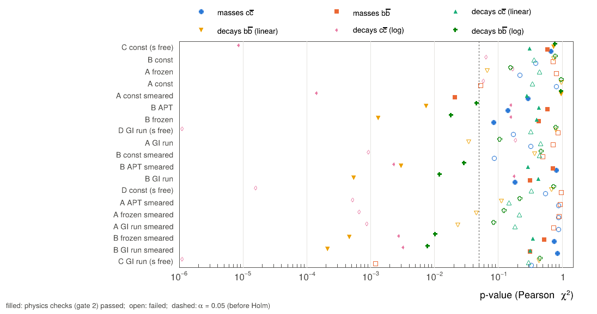
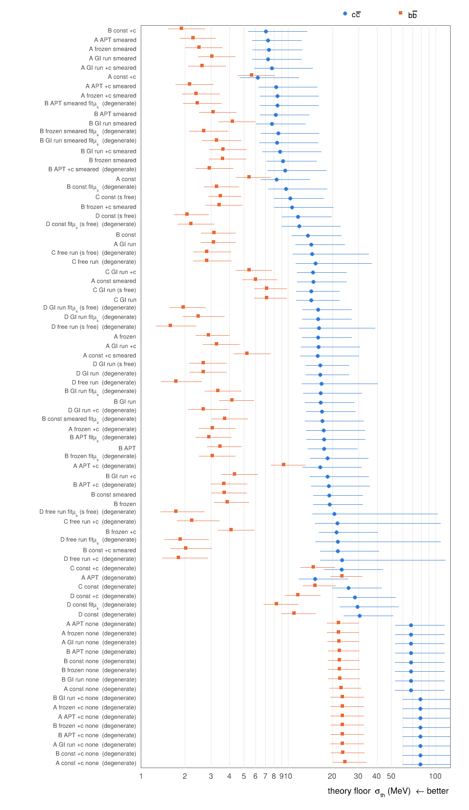
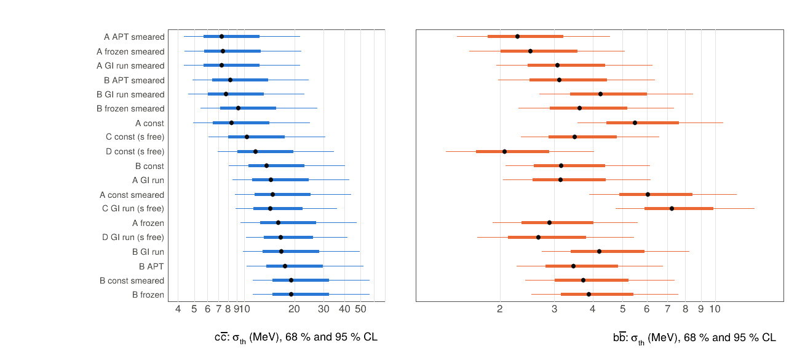
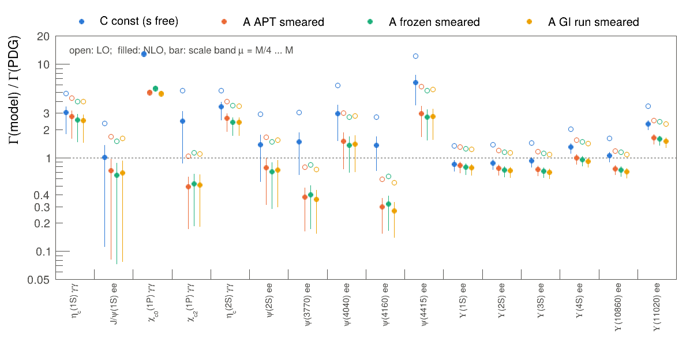
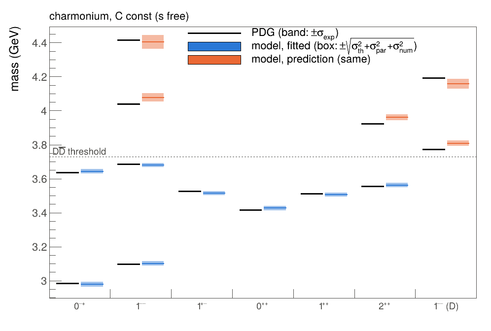
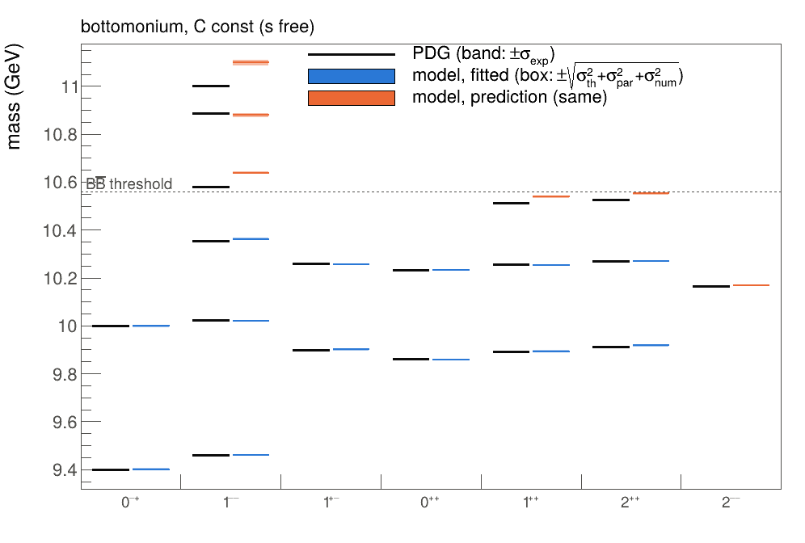
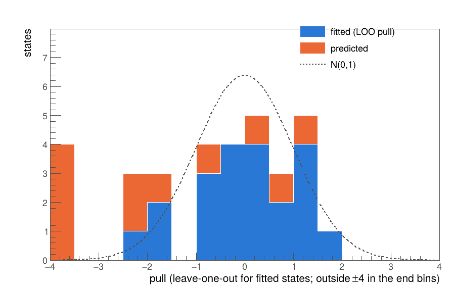
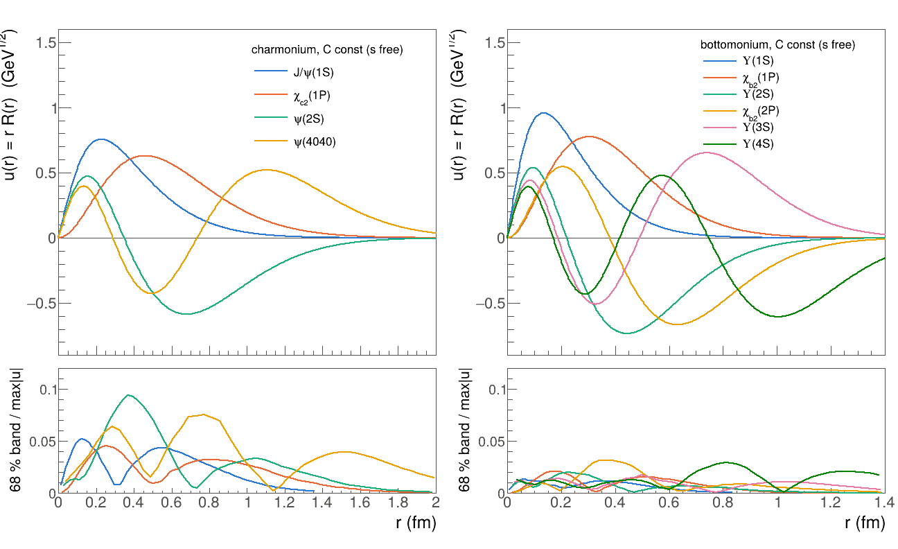
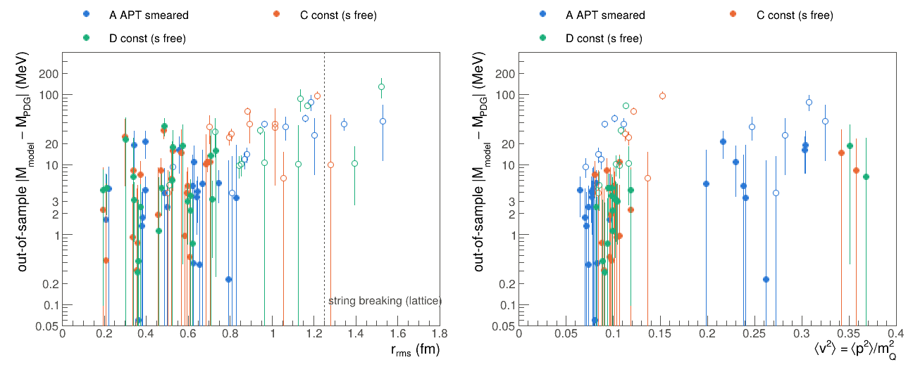

# Heavy-quarkonium spectroscopy across 80 model configurations

*qgem v1.0.0 analysis report. Every number comes from `analysis/sweep.py` and `analysis/analyze.py` (PyROOT,
ROOT 6.40.04). Each table has a CSV in [`data/`](data/), each figure a PDF in [`figures/`](figures/), and all
generated tables are in [`tables.md`](tables.md). Data: PDG 2026 (`pdg-2026.0.sqlite`). Methods:
[`../EXPLANATION.md`](../EXPLANATION.md).*

## Summary

**No model passes the selection rule.** The rule, fixed before the final sweeps, has two gates:

- **Gate 1, observables.** No rejection of the masses or of the measured decays.
- **Gate 2, physics.** Seven checks on the physical soundness of the fit.

Of the 19 models in the physical set, 7 fail exactly one check. Each of these models gets a different
observable or physics constraint wrong:

| model | the one failed check | what it gets wrong |
|---|---|---|
| C const (s free), GI relativized | decays c c̄ (log form) | Γ_γγ(χ_c0) is 13 × the PDG value |
| A const smeared | decays c c̄ (log form) | Γ_γγ(χ_c0) is 8 × the PDG value |
| B APT, screened, first-order spin | decays b b̄ (linear form) | Γ_ee(Υ(3S)) is 33 % low |
| B frozen | decays b b̄ (linear form) | Γ_ee(Υ(3S)) is 37 % low |
| B const | string tension | √b (b b̄) = 0.512 ± 0.003 GeV; lattice gives about 0.44 |
| A frozen | string tension | √b (b b̄) = 0.383 ± 0.003 GeV |
| A const | heavy-quark masses | m_b − m_c = 3.284 ± 0.022 GeV, below the window [3.342, 3.457] |

The **best compromise** by the rule (fewest failures, then the lowest AIC) is C const (s free). Its AIC of 34.16
is practically tied with that of B const (34.18).

1. **What the result means for the physics.** No configuration in the ensemble describes the masses, the
   annihilation widths and the physics constraints together.
   - Models with the spin terms in the Hamiltonian (smeared A/B, all of C/D) overpredict the χ_c0 two-photon
     width by a factor of 5–17. Their ³P₀ wave function is pulled in too far at short distance (§4.2).
   - The screened models with running couplings and first-order spin terms describe the P waves but
     underpredict the Υ(3S) leptonic width by about a third. Their |R_3S(0)|² is too small.
   - The constant-coupling models pass every decay test but fail the string tension or the quark masses.
2. **Masses alone do not discriminate.** At one declared mass error for all models, 17 of 19 models pass the
   mass test. The declared error is c c̄ 13.3 MeV and b b̄ 3.9 MeV, from the Paule–Mandel estimator pooled
   over the ensemble. The decays and the physics checks decide.
3. **The decay test was amended after the results were seen (§2.3).**
   - The registered test was linear in Γ, with a theory error proportional to the prediction. A pull in that
     test cannot fall below −1/f, about −2, so the test cannot reject any overprediction.
   - Under it, C const (s free) would have won, despite its ×13 Γ_γγ(χ_c0).
   - Gate 1 now also requires the same test on ln Γ, which is symmetric in over- and underprediction. A model
     must pass both forms, so the amendment can only add rejections.
   - All three verdicts are reported: linear, log, and both.
4. **The lowest theory floor is not the best model.**
   - A APT smeared has σ_th = 7.3 MeV (c c̄) and 2.3 MeV (b b̄).
   - It also has the best leave-one-out predictive density (pseudo-BMA weight 0.83).
   - It fails three checks: √b in both systems (0.342 ± 0.013 and 0.372 ± 0.003 GeV) and the χ_c0 width.
     The running-coupling Cornell models fit the spectrum by weakening confinement.
5. **One string tension for c c̄ and b b̄** is accepted in 12 of 19 models by a likelihood-ratio test. The joint
   fit improves the B_c prediction: the median |B_c − PDG| falls from 28 MeV (separate fits) to 10 MeV (joint
   fit).
6. **Above the open-flavour threshold** every model misses by 30–100 MeV. The model-averaged misses include
   ψ(4160) −80 MeV and Υ(10860) −50 MeV. This is the size of the coupled-channel shifts these models leave
   out.
7. **The Bayesian analysis agrees with the frequentist floor.** With σ_th marginalised, the credible intervals
   match the Q-profile intervals in every model. Posterior predictive checks reject nothing in the masses.

## 1. Setup

### 1.1 Data

| system | fitted (below threshold) | predicted (out of sample) | widths in the decay benchmark |
|---|---|---|---|
| c c̄ | η_c(1S), J/ψ, χ_c0,1,2(1P), h_c(1P), η_c(2S), ψ(2S): **8** | ψ(3770), χ_c2(3930), ψ(4040), ψ(4160), ψ(4415): **5** | Γ_γγ: η_c(1S), χ_c0, χ_c2, η_c(2S); Γ_ee: J/ψ, ψ(2S): **6** |
| b b̄ | η_b(1S,2S), Υ(1S,2S,3S), χ_bJ(1P,2P), h_b(1P,2P): **13** | Υ₂(1D), χ_b1,2(3P), Υ(4S), Υ(10860), Υ(11020): **6** | Γ_ee: Υ(1S,2S,3S): **3** |
| B_c | – | B_c⁺: **1**, from parameters interpolated between the two fits or from the joint fit | – |

- The χ_bJ(1P) and χ_bJ(2P) triplets share a common systematic, so their covariance is correlated.
- The widths are PDG partial widths. Where none is given, the width is the summary-table branching fraction ×
  total width: χ_c0, χ_c2 and η_c(2S) → γγ.

### 1.2 Configurations

The sweep covers 80 configurations; [`../EXPLANATION.md`](../EXPLANATION.md) describes the models.

- **A** (Cornell) and **B** (screened Cornell), crossed with:
  - four couplings: const, GI running, frozen, APT;
  - c = 0 or c free;
  - spin terms: none, first-order, or smeared;
  - the semi-relativistic kinetic energy;
  - for B, μ_s fitted.
- **C** (Godfrey–Isgur relativized) and **D** (screened GI), crossed with:
  - couplings: const, GI running, or free GI amplitudes;
  - c = 0 or c free;
  - the smearing parameter s fitted;
  - for D, μ_s fitted.

**Physical set: 19 configurations.** These have c = 0 (c is degenerate with the quark mass), spin terms
included, a non-degenerate Fisher matrix (condition < 10¹⁰), and are distinct (two parametrisations that give
the same fit count once). The selection, the grades and the pooled mass error all use the physical set.

**Basis.** n = 37 Gaussians, r₁ = 0.05, r_max = 15 GeV⁻¹. The numerical error σ_num comes from the nested
sizes n → 2n − 1. At n = 37 every level is within 0.1 MeV in 159 of 160 system fits. The exception, A APT +c
b b̄, is off by 3.4 MeV and lies outside the physical set.

## 2. How the models are graded

### 2.1 Standard methods

All grades use standard, published tests; references are in [`../EXPLANATION.md`](../EXPLANATION.md) §7b.

| quantity | method |
|---|---|
| declared theory error of the masses | Paule–Mandel random-effects estimator (Paule and Mandel 1982), solved with the full PDG covariance and **pooled over the physical set**: c c̄ **13.30 MeV**, b b̄ **3.87 MeV**. Every model is refitted at this one error, which favours none of them. |
| interval of a model's own floor | Q-profile (Viechtbauer 2007): the χ² test inverted |
| goodness of fit, masses | Pearson χ²/ν and p = P(χ²_ν ≥ χ²) at the declared error |
| goodness of fit, decays | Pearson χ² of the measured widths against the mass-only fit, which never saw them: linear in Γ, and in ln Γ (§2.3) |
| theory error of a width | α_s truncation (half the scale band μ = M/4 … M, correlated within a one-loop-factor class) in quadrature with the O(v²) NRQCD correction ⟨v²⟩Γ_NLO |
| multiple tests | Holm (1979), within a model |
| Bayesian check | posterior predictive p-values (Gelman, Meng and Stern 1996) |
| residual structure | Wald–Wolfowitz runs test, Shapiro–Wilk |
| comparison | AIC, AICc, BIC, Laplace evidence, Wilks tests (Holm, Benjamini–Hochberg), LOO predictive density, pseudo-BMA, stacking |

The floor σ_th is defined by χ² = ν. It is reported for each model but is **not** a grade: a floor fitted to a
model passes that model by construction.

### 2.2 The selection rule (pre-registered)

The rule and its thresholds were fixed before the 80-configuration sweeps. They are in `analysis/selection.py`
and in [`../EXPLANATION.md`](../EXPLANATION.md). The gate 2 thresholds were set while prototyping on one model
(A APT smeared), before the sweeps reported here.

**Gate 1, observables.** No rejection at α = 0.05, after Holm's correction, of four Pearson χ² tests:

- the masses of c c̄ and of b b̄, at the declared error;
- the decays of c c̄ and of b b̄.

All four tests use the same declared-error fit (the `floor2` sweep).

**Gate 2, physics.** Every check below must pass at its threshold. Checks (d)–(f) are applied within 2σ of the
parametric error from the model's own fit (the `main` sweep).

| | check | threshold |
|---|---|---|
| (a) | non-degenerate fit | Fisher condition < 10¹⁰ |
| (b) | basis converged | nested size meeting 0.1 MeV ≤ 37 |
| (c) | radial nodes | nodes = n for every state |
| (d) | heavy-quark masses | m_b − m_c within [3.342, 3.457] GeV, from the spin-averaged B and D mesons |
| (e) | string tension | √b within 0.44 ± 0.04 GeV (lattice), both systems |
| (f) | P-wave spin structure | 1P centre of gravity − h within 2σ of the PDG value; σ combines the declared and the parametric error |
| (g) | non-relativistic expansion | ⟨v²⟩ < 0.5 for every fitted state |

**Ranking.** Among the models that pass both gates, the lowest AIC = χ²_masses + χ²_decays + 2p wins, where p
counts the free parameters of both systems. If no model passes, there is no winner. The model with the fewest
failed checks is then reported as the best compromise, with AIC breaking ties.

The two gates measure different things:

- **The mass grade is relative to the ensemble.** The declared error is what the physical set as a whole
  achieves.
- **The decay grade is absolute.** It uses the experimental errors plus a standard theory error, from a fit
  that never saw the widths.

### 2.3 Amendment of the decay test (after the results were seen)

**The defect.** The registered decay test is linear in Γ. Its theory error is proportional to the prediction
itself: σ_th = f·Γ_NLO, where f combines the scale band and ⟨v²⟩. The pull is then

  z = (Γ_PDG − Γ_NLO)/(f Γ_NLO) → −1/f  as Γ_NLO → ∞.

With f ≈ 0.5 for charmonium, no overprediction, however large, gives a pull below −2. The test cannot reject an
overprediction. The defect was found after the final sweeps, when the best model under the registered rule,
C const (s free), passed the c c̄ decays with Γ_γγ(χ_c0) = 31.6 keV against 2.43 keV in the PDG.

**The amendment.** Gate 1 now requires **both** forms of the decay test:

- the registered linear test;
- the same Pearson test on r = ln(Γ_PDG/Γ_NLO), with V = D⁻¹(V_th + V_par)D⁻¹ + diag(σ_exp/Γ_PDG)² and
  D = diag(Γ_NLO).

Each form is Holm-corrected over its own four tests. The log form treats the theory error as multiplicative,
so it is symmetric in over- and underprediction. On its own it is milder than the linear form on
underpredictions, since ln(1 + x) < x. That is why the amendment requires both forms rather than replacing one
with the other: it can only add rejections, never pass a model the registered rule rejected. AIC and the
tiebreak keep the registered linear decay χ².

**What changes.** The verdict changes for two models, and the log form alone would change it for two more:

| verdict under | passing models |
|---|---|
| linear (as registered) | C const (s free), A const smeared |
| log form alone | B APT, B frozen |
| both (amended rule) | none |

The C++ `decay_benchmark` output and the decay posterior predictive p-value are still in the linear form in
v1.0.0. The log form is computed in `analysis/selection.py` from the logged widths, scale bands, ⟨v²⟩ and
parametric errors. The parametric errors are diagonal as logged.

## 3. Selection result



*The six goodness-of-fit p-values of every model in the physical set. Filled: passes gate 2. Open: fails it.
Dashed: α = 0.05 before Holm.*

| configuration | p masses c c̄ | p masses b b̄ | p decays c c̄ (lin / log) | p decays b b̄ (lin / log) | AIC | failed checks |
|---|---|---|---|---|---|---|
| C const (s free) | 0.662 | 0.595 | 0.311 / **8.6e-6** | 0.742 / 0.786 | 34.2 | decays c c̄ [log] |
| B const | 0.385 | 0.722 | 0.364 / 0.065 | 0.731 / 0.786 | 34.2 | **√b b b̄ = 0.512 ± 0.003** |
| A frozen | 0.219 | 0.812 | 0.445 / 0.168 | 0.067 / 0.156 | 39.9 | **√b b b̄ = 0.383 ± 0.003** |
| A const | 0.813 | 0.053 | 0.341 / 0.059 | 0.971 / 0.972 | 41.3 | **m_b − m_c = 3.284 ± 0.022** |
| A const smeared | 0.294 | 0.021 | 0.282 / **1.4e-4** | 0.965 / 0.973 | 48.2 | decays c c̄ [log] |
| B APT | 0.140 | 0.598 | 0.436 / 0.160 | **0.0074** / 0.046 | 48.2 | decays b b̄ [linear] |
| B frozen | 0.085 | 0.433 | 0.404 / 0.159 | **0.0013** / 0.018 | 55.1 | decays b b̄ [linear] |
| D GI run (s free) | 0.172 | 0.856 | 0.320 / 9.7e-7 | 0.798 / 0.801 | 33.2 | ⟨v²⟩ c c̄ = 0.51; decays c c̄ [log] |
| A GI run | 0.324 | 0.721 | 0.461 / 0.187 | 0.034 / 0.105 | 41.2 | √b c c̄, b b̄ |
| B const smeared | 0.086 | 0.494 | 0.446 / 9.3e-4 | 0.373 / 0.472 | 41.5 | √b b b̄; decays c c̄ [log] |
| B APT smeared | 0.821 | 0.717 | 0.290 / 0.0023 | 0.0030 / 0.029 | 45.0 | decays b b̄ [linear]; c c̄ [log] |
| B GI run | 0.182 | 0.317 | 0.424 / 0.180 | 5.4e-4 / 0.012 | 56.2 | decays b b̄ [linear, log] |
| D const (s free) | 0.546 | 0.972 | 0.329 / 1.6e-5 | 0.680 / 0.730 | 30.3 | ⟨v²⟩ c c̄; √b b b̄; decays c c̄ [log] |
| A APT smeared | 0.877 | 0.941 | 0.146 / 5.2e-4 | 0.111 / 0.217 | 36.2 | √b c c̄, b b̄; decays c c̄ [log] |
| A frozen smeared | 0.872 | 0.896 | 0.214 / 6.5e-4 | 0.045 / 0.122 | 37.9 | √b c c̄, b b̄; decays c c̄ [log] |
| A GI run smeared | 0.877 | 0.734 | 0.181 / 8.6e-4 | 0.023 / 0.084 | 41.7 | √b c c̄, b b̄; decays c c̄ [log] |
| B frozen smeared | 0.751 | 0.527 | 0.350 / 0.0028 | 4.6e-4 / 0.010 | 50.6 | decays b b̄ [linear, log]; c c̄ [log] |
| B GI run smeared | 0.851 | 0.314 | 0.315 / 0.0033 | 2.1e-4 / 0.0078 | 54.4 | decays b b̄ [linear, log]; c c̄ [log] |
| C GI run (s free) | 0.329 | 0.0012 | 0.299 / 2.5e-7 | 0.432 / 0.451 | 56.9 | masses b b̄; ⟨v²⟩ c c̄; decays c c̄ [log] |

(Raw p-values. Rejections are after Holm within each form; √b and m_b − m_c are in GeV. The full table, with
every check value and its tolerance, is [`data/selection.csv`](data/selection.csv).)

### 3.1 Robustness

- **Gate 2 at the central values only**, without the 2σ allowance, is passed by 4 of 19 models: B frozen,
  B GI run, B frozen smeared and B GI run smeared. All four fail the b b̄ decays.
- **Gate 2(f) has little power.** At the declared error, the c c̄ tolerance on cog − h is about ±33 MeV. The
  models give 0.2–16 MeV, against a PDG value of 0.00 MeV, and all pass. At the PDG precision, 17 of 19 would
  fail (§6).
- **Some passes rely on the 2σ allowance.**
  - C const (s free): √b (c c̄) = 0.396 ± 0.020 GeV, m_b − m_c = 3.270 ± 0.051 GeV, and ⟨v²⟩ max = 0.495.
  - B APT: m_b − m_c = 3.332 ± 0.094 GeV.
  - Both central values of m_b − m_c are below the window.
- **Raw p below 0.05, passed after Holm.**
  - A const smeared: masses b b̄, p = 0.021.
  - B APT: decays b b̄ in the log form, p = 0.046.

## 4. Goodness of fit

### 4.1 Masses at the declared error

| | |
|---|---|
|  |  |

*Left: each model's own floor. Right: its Q-profile interval, 68 % (thick) and 95 % (thin).*

**The mass test.** 17 of 19 models pass the combined mass test at 5 %. The two failures:

- A const smeared, p = 0.027;
- C GI run (s free), p = 0.0025, failing in b b̄ (χ²/ν = 2.91).

With ν = 4 in c c̄, the c c̄ test has little power.

**Without a theory error, every model is rejected.** Cochran's Q, using only the PDG errors, is 7 × 10⁴ to
3 × 10⁶ for c c̄ and 4 × 10² to 2 × 10⁴ for b b̄. No potential model reaches the precision of the data. The
declared error is therefore a required part of the model, estimated once for the ensemble.

**Out-of-sample calibration.** Each fitted state is predicted by a refit without it, with the floor re-solved.
The standardised misses have the expected t-distribution width:

| system | left out | RMS t | expected |
|---|---|---|---|
| c c̄ | single states (LOO) | 1.95 | 1.70 |
| b b̄ | single states (LOO) | 1.18 | 1.15 |
| b b̄ | whole multiplets (LMO) | 1.65 | 1.24 |
| c c̄ | whole multiplets (LMO) | 4.54 pooled; 1.16 median model | – |

The pooled c c̄ LMO value is dominated by a few models; the median model gives 1.16.

**Residual structure.** The Wald–Wolfowitz runs test on the fitted states gives p ≥ 0.64 for c c̄ in every
model. For b b̄ it gives p ≥ 0.02; two models are below 0.05 (B GI run smeared and C GI run (s free)). Only
those two show a drift pattern that would point to a missing term.

### 4.2 Decays: the held-out benchmark



*Γ(model)/Γ(PDG) for every measured width. Open markers: LO (Van Royen–Weisskopf). Filled markers: NLO at
μ = M/2. Bars: the scale band, μ = M/4 … M.*

**The two-photon P-wave widths separate the spin treatments.** The ratio Γ_γγ(χ_c2)/Γ_γγ(χ_c0) does not depend
on the normalisation of the wave function.

- With first-order spin terms, ³P₀ and ³P₂ share one radial function, so the LO ratio is exactly 4/15 = 0.267.
  The code reproduces this in every first-order model, which checks the P-wave width code.
- With the spin terms in H (smeared A/B, all of C/D), the attractive ³P₀ spin–orbit and tensor forces contract
  the ³P₀ wave function. The ratio falls to 0.03–0.10, against the PDG value of 0.230 ± 0.017.
- Γ_γγ(χ_c0) itself is 1.6–2.1 × the PDG value with first-order spin terms, 4.9–10 × with smeared A/B, and
  13–17 × with C/D (13.0 × in C const (s free)).

**The leptonic widths of b b̄ separate the potentials.** The theory error is small here (⟨v²⟩ ≈ 0.1), so the
widths measure |R_nS(0)|² state by state. The screened running-coupling models (B APT, frozen, GI run)
underpredict Γ_ee(Υ(3S)) by 33–40 % at NLO. The constant-coupling models and the C/D models reproduce every
b b̄ leptonic width within 1.7σ.

**The c c̄ widths have large theory errors.** At μ = M/4, the one-loop factor for J/ψ → ee nearly vanishes, so
the c c̄ band reaches the edge of perturbative control.

**Posterior predictive p-values.** The decay ppp is still computed in the linear form. In the smeared c c̄
models it is 0.02–0.05, against a frequentist p of 0.15–0.45. The two differ for a definite reason:

- The frequentist test puts the parametric error into the covariance V.
- The ppp scores each posterior draw against V_exp + V_theory alone. The parametric spread therefore counts
  as discrepancy.

Smeared models have large parametric width errors (χ_c0: 1.8–4.8 keV), so their ppp is lower.

**Fitting the widths instead.** Fitting the masses and widths together moves the best compromise by at most
0.43σ (in s) and raises its c c̄ floor from 10.3 to 10.7 MeV; see
[`tables.md`](tables.md#masses-and-widths-fitted-together-study). The selection keeps the widths out of the
fit, so that the masses are not traded for the widths.

### 4.3 Bayesian inference

The posterior is computed for the parameters and σ_th together:

- prior flat in u, which is ln θ for positive parameters;
- prior flat in ln σ_th on [10⁻⁵, 0.05] GeV;
- the full Gaussian likelihood, including ln det V;
- 4 Metropolis chains, started at the mode.

| model | system | σ_th median [16 %, 84 %] (MeV) | Q-profile 68 % | ppp χ² | ppp max\|z\| | R̂ | n_eff |
|---|---|---|---|---|---|---|---|
| C const (s free) | c c̄ | 11.6 [8.1, 18.0] | [8.0, 17.3] | 0.51 | 0.51 | 1.049 | 90 |
| C const (s free) | b b̄ | 3.8 [2.9, 4.9] | [2.9, 4.8] | 0.52 | 0.43 | 1.026 | 153 |
| B APT | c c̄ | 19.1 [13.7, 28.5] | [13.6, 29.4] | 0.52 | 0.44 | 1.009 | 260 |
| B APT | b b̄ | 3.6 [2.8, 4.8] | [2.8, 4.8] | 0.50 | 0.51 | 1.009 | 468 |
| A APT smeared | c c̄ | 7.8 [5.6, 12.0] | [5.7, 12.3] | 0.50 | 0.51 | 1.016 | 374 |
| A APT smeared | b b̄ | 2.4 [1.9, 3.2] | [1.8, 3.2] | 0.51 | 0.57 | 1.002 | 652 |

- **Credible intervals.** The posterior σ_th intervals agree with the Q-profile intervals in every model.
- **ppp of χ².** With σ_th marginalised, the ppp of χ² is close to 0.5 by construction. It is not used as
  evidence for a model.
- **ppp of max|z|.** This tests single states. Its lowest value in the physical set is 0.29.
- **Convergence.** C GI run (s free) c c̄ (R̂ = 1.102) has **not converged**, and its posterior is not used.
  The degenerate fitted-μ_s models, outside the physical set, do not converge either: their posterior drifts to
  the σ_th prior bound.

## 5. The best compromise: C const (s free)

This section shows the best compromise in full. It is **not** a winner: its c c̄ two-photon widths fail the
log-form test.

**Parameters** (own floor; ± parametric error):

| | m_Q (GeV) | b (GeV²) | s | α_s | σ_th (MeV), Q-profile 68 % |
|---|---|---|---|---|---|
| c c̄ | 1.527 ± 0.049 | 0.157 ± 0.016 | 0.81 ± 0.09 | 0.590 ± 0.068 | 10.3 [8.0, 17.3] |
| b b̄ | 4.797 ± 0.012 | 0.185 ± 0.005 | 0.553 ± 0.034 | 0.409 ± 0.017 | 3.5 [2.9, 4.8] |
| joint (b shared) | – | 0.182 ± 0.005 | – | – | 12.3 / 3.5 |

- Sharing b between the systems is accepted: Δχ² = 3.22 for one parameter, p = 0.073.
- Sharing b and s is rejected (p = 5 × 10⁻⁹).
- The fitted s is below the GI value of 1.55 in both systems.

| | |
|---|---|
|  |  |

*Model against PDG. Box: ±√(σ_th² + σ_par² + σ_num²). Blue: fitted states. Orange: predicted states.*



*Exact leave-one-out pulls for the fitted states, with the floor re-solved without each state. Prediction
pulls for the predicted states; the end bins collect |pull| > 4.*

**Predictions** (model − PDG, MeV; ± parametric):

| c c̄ | | b b̄ | |
|---|---|---|---|
| ψ(3770) | +35 ± 11 | Υ₂(1D) | +4 ± 2 |
| χ_c2(3930) | +38 ± 15 | χ_b1(3P) | +25 ± 4 |
| ψ(4040) | +38 ± 22 | χ_b2(3P) | +27 ± 4 |
| ψ(4160) | −34 ± 27 | Υ(4S) | +58 ± 5 |
| ψ(4415) | −10 ± 40 | Υ(10860) | −6 ± 8 |
| | | Υ(11020) | +97 ± 11 |
| **B_c⁺**, separate fits | −25.6 ± 13.7 | **B_c⁺**, joint b | −2.8 ± 10.4 |

The B_c errors are the 16–84 % half-spread of 100 parameter draws. They do not include the systematic of
interpolating between the two systems.

**Annihilation widths** (keV; NLO at μ = M/2, ± parametric ± theory; * = BR × total width):

| state | process | LO | NLO | PDG | NLO/PDG |
|---|---|---|---|---|---|
| η_c(1S) | γγ | 30.9 | 19.6 ± 1.6 ± 10.7 | 6.39 ± 0.46 | 3.1 |
| J/ψ | ee | 12.9 | 5.57 ± 0.40 ± 3.96 | 5.53 ± 0.10 | 1.01 |
| χ_c0(1P) | γγ | 31.0 | 31.6 ± 3.2 ± 15.6 | 2.43 ± 0.11 * | **13.0** |
| χ_c2(1P) | γγ | 2.92 | 1.37 ± 0.09 ± 0.79 | 0.559 ± 0.033 * | 2.5 |
| η_c(2S) | γγ | 10.7 | 7.1 ± 0.4 ± 3.4 | 2.0 ± 1.3 * | 3.5 |
| ψ(2S) | ee | 6.77 | 3.23 ± 0.09 ± 1.95 | 2.327 ± 0.039 | 1.39 |
| Υ(1S) | ee | 1.81 | 1.146 ± 0.028 ± 0.185 | 1.340 ± 0.018 | 0.86 |
| Υ(2S) | ee | 0.840 | 0.538 ± 0.014 ± 0.082 | 0.612 ± 0.011 | 0.88 |
| Υ(3S) | ee | 0.641 | 0.413 ± 0.012 ± 0.066 | 0.443 ± 0.008 | 0.93 |

**Wave functions.** Each wave function is rebuilt from its logged Gaussian coefficients alone. The norm is 1 to
within 1.1 × 10⁻¹⁰, and the radial nodes equal n in all 32 states. The 68 % parametric band, from 40 draws, is
at most 9 % of max|u| in c c̄ (ψ(2S)) and at most 3 % in b b̄.



## 6. Validity audit

Physics compared with references the fits never saw. Failures are kept.

| check | reference | result | verdict |
|---|---|---|---|
| 1S hyperfine, c c̄ | PDG 112.8 MeV | 121–128 MeV (medians by spin treatment); best compromise 123.6 ± 7.2 | 1–2σ high |
| 1S hyperfine, b b̄ | PDG 61.7 MeV | 61–64 MeV; best compromise 60.6 ± 1.8 | **pass** |
| 2S hyperfine, c c̄ | PDG 48.3 MeV | best compromise 37.7 ± 3.5 (parametric error only); smeared running-coupling A/B 46–51 | best compromise low |
| fine-structure ratio ρ, c c̄ | PDG 0.48 | 0.56 smeared, 0.66 GI, 0.76 first order (medians); 17 of 19 models above; A const smeared 0.41, B const smeared 0.32 | **fail** in most models |
| fine-structure ratio ρ, b b̄ | PDG 0.58 | 0.69–0.82 (medians); B const smeared 0.54, A const smeared 0.59 | **fail** in most models |
| cog − h, c c̄ | PDG 0.00 MeV | 0.2–16 MeV; 17 of 19 models above 5 MeV; best compromise 13.5 ± 3.4 | **fail** at PDG precision; pass at the declared error (gate 2f) |
| m_b − m_c (heavy-quark symmetry) | [3.342, 3.457] GeV | separate fits: 6 of 19 inside, median 3.332 ± 0.042; joint fits: median 3.382 ± 0.017 | separate fits low; joint fits **pass** |
| √b | lattice ≈ 0.44 GeV | medians 0.421 ± 0.018 (c c̄), 0.436 ± 0.004 (b b̄), 0.434 ± 0.004 (joint) | ensemble **pass**; A models low; B/D const high |
| wave functions from the log | norm = 1, nodes = n | 1.1 × 10⁻¹⁰; 0 of 32 wrong | **pass** |
| ψ(3770) S–D mixing | Γ_ee(ψ(3770))/Γ_ee(ψ(2S)) | best compromise: −37.8° ± 0.6° or 0.1° ± 0.6°; tensor force alone 1.6° | the tensor force is too weak |
| Γ_γγ(χ_c2)/Γ_γγ(χ_c0) | PDG 0.230 ± 0.017 | first order: 4/15 exactly; spin terms in H: 0.03–0.10 | **fail** with the spin terms in H |

**The P-wave spin structure fails in most models.** Two patterns are common in c c̄:

- a 1P centre of gravity above h_c;
- a fine-structure ratio ρ above the PDG value.

Only the smeared constant-coupling models avoid both, and they fail other checks. A spin-orbit and tensor
structure from one-gluon exchange plus scalar confinement does not describe the c c̄ P waves at the level of
the data in any of the potentials and couplings studied here.

## 7. Diagnostics and studies

### 7.1 Truncation diagnostic

This is a diagnostic, not a grade. σ_a is the part of the first omitted kinetic term,
−⟨p⁴⟩(1/8m₁³ + 1/8m₂³), that the parameters cannot absorb. Over the A/B models:

- The median σ_a/σ_th is 1.19 (c c̄) and 0.91 (b b̄). The omitted p⁴ term alone is the size of the fitted
  floor.
- The coefficient λ of the misfit on that term is −0.44 (c c̄) and +0.49 (b b̄), each ± 0.3–0.5. The residuals
  are not the p⁴ term alone: the Darwin, orbit–orbit and 1/m potential terms are of the same order and are
  also omitted.

### 7.2 One accuracy scale for both flavours?

Take the floor of state i as κ·u_i and test whether one κ fits both flavours:

| u_i | median κ_c/κ_b | models rejected (of 19) |
|---|---|---|
| ⟨v²⟩_i | 0.97 | 0 |
| ⟨p⁴⟩_i/8m³ | 0.97 | 0 |
| uniform | – | 16 |

The theory error of a potential model scales with the heavy-quark velocity, as NRQCD power counting implies.

### 7.3 Joint fits

- **b shared.** Universality is accepted in 12 of 19 models. The median |B_c − PDG| falls from 28 MeV
  (separate fits) to 10 MeV (joint fit).
- **b and the coupling (A/B), or b and the smearing (C/D), shared.** Rejected in 7 of 15 models:
  - all smeared running-coupling models except B frozen smeared (p ≤ 0.03);
  - C const and D const.

The confining force is flavour-independent within the errors. The short-distance parameters of most smeared
and constant-coupling spin-in-H models are not.

### 7.4 Information criteria and nested tests

At the declared error, the information criteria disagree:

- AIC and BIC favour A APT smeared.
- AICc and the Laplace evidence favour D GI run (s free), with weights 0.81 and 0.64. It has the fewest
  parameters (p = 3).
- Pseudo-BMA and stacking of the LOO predictive density favour A APT smeared (0.83 and 0.67).

Of 132 Wilks tests at the declared error, 23 give p < 0.05, against about 7 expected by chance; 10 survive
Holm. Kendall τ between the fit criteria ranges from 0.24 to 1.0. B_c accuracy and above-threshold accuracy
are uncorrelated with every fit criterion (|τ| ≤ 0.33). These criteria rank the fit only. The selection rule
adds the absolute decay test and the physics constraints.

### 7.5 Cross-validation and overfitting

- **Repeated 4-fold cross-validation**, test RMS:
  - best compromise: 24 MeV (c c̄; median 16) and 5.7 MeV (b b̄);
  - A APT smeared: 15 and 5.1 MeV.
- **Overfitting.** The observed/expected LOO inflation of the best compromise is 1.12 (c c̄) and 1.08 (b b̄),
  against 1 for a correctly specified linearised model. There is no sign of overfitting.
- **Multiplets.** Leaving out whole multiplets is harder for the best compromise: 38 MeV in c c̄, against 18
  for A APT smeared.

### 7.6 Minimisers and basis

**Minimisers.** Levenberg–Marquardt from 9 starts ends more than 5 % above the final minimum in 40 of 160
system fits; Minuit2 from one start does so in 2. Every reported fit therefore starts from the best minimum
found by either minimiser, or by any model nested in it.

**Basis.** The basis converges at n = 37 to 0.1 MeV in 159 of 160 fits. The largest change from n = 73 to 145
is 0.41 MeV.

### 7.7 Limits of the potential description



Out-of-sample misses, binned by r_rms:

- below the open-flavour threshold, they stay at the floor;
- above it, beyond about 1 fm, they reach 35–80 MeV in c c̄ and 38–45 MeV in b b̄.

The largest misses are beyond r_rms ≈ 1 fm. This is near the lattice string-breaking distance of 1.25 fm
(Bali et al., PRD 71, 114513 (2005)).

### 7.8 Semi-relativistic kinetic energy and state-dependent floors

Replacing p²/2m by √(p²+m²) − m in the A/B models changes the floors and the misses:

| quantity | change |
|---|---|
| c c̄ floor | +3 to +7 MeV |
| b b̄ floor | −0.3 to −2.0 MeV (A APT without smearing: 23.4 → 2.8 MeV) |
| above-threshold c c̄ misses, B models | −23 to −30 MeV |

A floor proportional to ⟨v²⟩ improves the LMO predictive density over a uniform floor: Σ elpd 146 against 58. A
floor proportional to ⟨p⁴⟩ improves LOO but worsens LMO.

## 8. Limitations

- **No coupled channels.** States above threshold are computed as pure q q̄ levels. The misses of 30–100 MeV
  there are the expected size of meson-loop shifts.
- **Low power in c c̄.** With 8 fitted states and 4 parameters, ν = 4, and the c c̄ mass test cannot reject a
  model whose σ_th is within a factor of about 2 of the declared error.
- **The declared error is an ensemble property.** A model that passes the mass test describes the masses as
  well as the ensemble does, not to the PDG precision.
- **The decay test was amended after the results were seen** (§2.3). The amendment is disclosed, can only add
  rejections, and all three verdicts are reported.
- **Width theory.** NLO only, with a scale band that reaches α_s ≈ 0.5 in c c̄. Relativistic corrections enter
  only through the ⟨v²⟩Γ error term.
- **Global minimum.** Two minimisers and nested seeding give the best minima found, not provably global ones.
- **B_c.** The parameters are interpolated between the systems, or taken from the joint fit. The
  interpolation systematic is not included.

Planned for v2.0.0 ([`../../ROADMAP.md`](../../ROADMAP.md)):

- the log-form decay test and its posterior predictive check in the C++ output;
- a momentum-space solver;
- coupled channels above threshold.

## 9. Reproducing

```bash
cmake --preset release && cmake --build --preset release && ctest --preset release
python3 analysis/sweep.py all -j 32   # every sweep in order (hours on 32 cores; resumable)
python3 analysis/analyze.py           # results/qgem_sweep.root, docs/report/{figures,data,tables.md}
```

- Every run writes its table to `results/<sweep>/<tag>.txt` and `<tag>.json`. The analysis reads only the JSON.
- The ROOT file has two trees: `fits`, one row per configuration and system, and `states`, one row per state.
- The selection is `analysis/selection.py` (`select_both`). It reads the `main`, `floor2` and `nested` sweeps.
